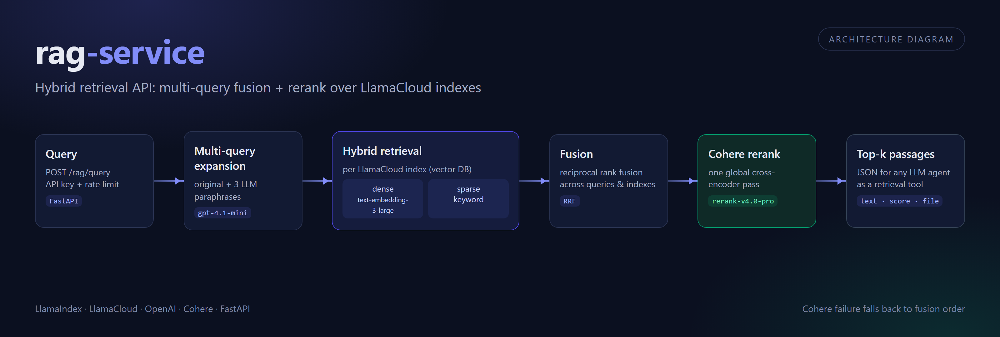
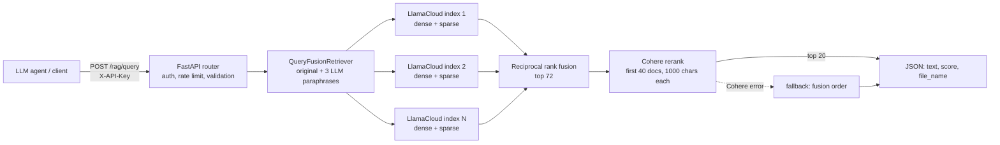
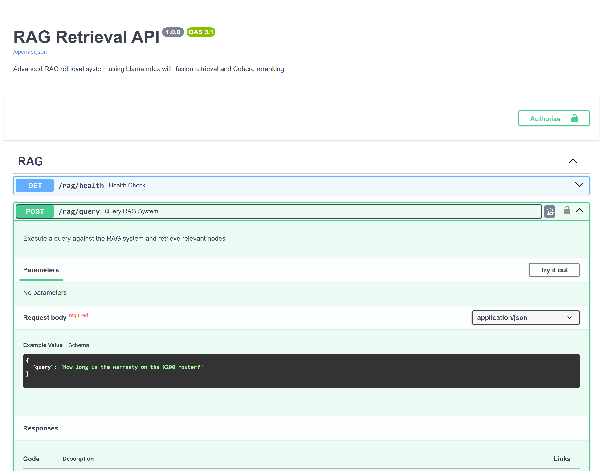

# rag-service



**Hybrid retrieval API: multi-query fusion + rerank over LlamaCloud indexes.** One HTTP call turns a user question into a short, reranked list of source passages that any LLM agent can use as a retrieval tool.


## Highlights

- **Two-stage retrieval, recall then precision**: a wide hybrid (dense + sparse) search across several LlamaCloud vector indexes, then one global Cohere cross-encoder rerank.
- **Multi-query expansion**: the LLM writes 3 paraphrases of the question; all 4 queries hit every index and the results are merged with reciprocal rank fusion.
- **Built to keep serving**: Cohere failures fall back to fusion order instead of a 500, transient retrieval timeouts are retried once, index loading retries with backoff.
- **Hardened for the open internet**: fail-closed API key auth, constant-time key compare, per-client rate limit, schema-level query length cap, no internal errors or index names leaked, docs hidden unless `DEBUG`.
- **Agent-ready output**: plain JSON (`text`, `score`, `file_name`), so it plugs in as a tool for any LLM agent platform (for example Dify or LangGraph). Multilingual: used in production on a Persian-language corpus.

## Why it's interesting

- **One reranker, not two.** LlamaCloud can rerank per index, but with N indexes x 4 queries that truncates each result list *before* fusion and reranks twice. Here per-index reranking is off (`ENABLE_RERANKING=False`), so all raw hybrid candidates reach fusion and a single Cohere pass picks the final top-N ([`app/core/config.py`](app/core/config.py), [`app/services/rag_service.py`](app/services/rag_service.py)).
- **A rerank call that fits the network.** Instead of LlamaIndex's `CohereRerank` (which sends metadata-padded text), `_cohere_rerank_proxy_safe` sends only the first `COHERE_MAX_DOCS` candidates, plain text cut to `COHERE_DOC_CHARS`, through a fresh `httpx` client with an explicit timeout and optional proxy, then maps scores back onto the full-text nodes. Out-of-range result indexes are dropped.
- **Honest health check.** `/rag/health` makes no external calls and reports `ready` only when every configured index produced a retriever and the reranker is configured.
- **Careful about what it does not do.** No `LongContextReorder` (the output is a ranked list, not a stuffed prompt), and no client-side embedding model: LlamaCloud embeds the query server-side with the model the index was ingested with.

## Architecture



Pipeline per request ([`RAGService.retrieve`](app/services/rag_service.py)):

| Stage | What happens | Defaults (env) |
|---|---|---|
| Query expansion | `QueryFusionRetriever` asks the LLM for paraphrases | `FUSION_NUM_QUERIES=4` (1 original + 3), `LLM_MODEL=gpt-4.1-mini`, `LLM_TEMPERATURE=0.1` |
| Hybrid retrieval | Each query runs on every LlamaCloud index in `chunks` mode, dense + sparse, blended by `alpha` | `DENSE_SIMILARITY_TOP_K=50`, `SPARSE_SIMILARITY_TOP_K=50`, `ALPHA=0.35`, `INDEX_NAMES` |
| Fusion | Reciprocal rank fusion over all (query x index) lists, async | `FUSION_MODE=reciprocal_rerank`, `FUSION_SIMILARITY_TOP_K=72` |
| Rerank | One Cohere call over the fused pool, scores replace fusion scores | `COHERE_MODEL=rerank-v4.0-pro`, `COHERE_TOP_N=20`, `COHERE_MAX_DOCS=40`, `COHERE_DOC_CHARS=1000` |
| Response | Nodes mapped to `{text, score, file_name}` plus `total`, `processing_time`, echoed `query` | - |

Timeouts and retries: Cohere call timeout `COHERE_HTTP_TIMEOUT` (25 s in code, 45 s in `.env.example`); fusion retried once when the error looks transient (timeout, connection reset); each index load retried up to 5 times at startup; Gunicorn worker timeout 300 s in the `Dockerfile`. There is no response cache and no score threshold: the result is always the reranked top-N (or fewer).

Embeddings: the indexes were ingested in LlamaCloud with OpenAI `text-embedding-3-large` (3072 dims). The query embedding is computed by LlamaCloud with the same model; `EMBEDDING_MODEL` in config is documentation only.

## Tech stack

FastAPI, Pydantic v2, LlamaIndex (`QueryFusionRetriever`), LlamaCloud managed indexes (hybrid vector + keyword search), OpenAI (`gpt-4.1-mini` for query expansion, `text-embedding-3-large` at ingestion), Cohere Rerank, Gunicorn + Uvicorn workers, uv, Docker Compose.

## API

`POST /rag/query` with header `X-API-Key`:

```bash
curl -X POST http://127.0.0.1:8000/rag/query \
  -H "Content-Type: application/json" \
  -H "X-API-Key: $APP_API_KEY" \
  -d '{"query": "How long is the warranty on the X200 router?"}'
```

Response (fictional content):

```json
{
  "nodes": [
    {
      "text": "All X200 routers ship with a 24-month limited warranty covering hardware defects...",
      "score": 0.91,
      "file_name": "x200-warranty.md"
    },
    {
      "text": "To start a warranty claim, contact support with the serial number printed under the device...",
      "score": 0.62,
      "file_name": "support-claims.md"
    }
  ],
  "total": 2,
  "processing_time": 3.45,
  "query": "How long is the warranty on the X200 router?"
}
```

| Endpoint | Auth | Notes |
|---|---|---|
| `GET /` | none | Basic info |
| `GET /rag/health` | none | `{"status": "ready", "indexes_loaded": 3}`; index names only when `DEBUG=true` |
| `POST /rag/query` | `X-API-Key` | 403 bad/missing key, 422 empty or over `MAX_QUERY_LENGTH`, 429 with `Retry-After`, 500 with a correlation id only |
| `GET /docs` | none | Swagger UI, mounted only when `DEBUG=true` |



## Getting started

Requirements: Python 3.13, [uv](https://docs.astral.sh/uv/), API keys for LlamaCloud, OpenAI and Cohere, and one or more LlamaCloud indexes.

```bash
uv sync
cp .env.example .env   # fill in keys, INDEX_NAMES, PROJECT_NAME, APP_API_KEY
uv run uvicorn app.main:app --host 127.0.0.1 --port 8000
```

The app refuses to start without `APP_API_KEY`. Production-style run (same as the container):

```bash
uv run gunicorn app.main:app -k uvicorn.workers.UvicornWorker -w 4 -b 0.0.0.0:8000 --timeout 300
```

Docker:

```bash
docker build -t rag-service .
IMAGE_NAME=rag-service PROJ_NAME=rag-service PORT_NUM=8000 LOG_ADDRESS=udp://127.0.0.1:12201 LOG_TAG=rag-service docker compose up -d
```

`compose.yml` adds a health check, `no-new-privileges`, dropped capabilities, memory/CPU limits and GELF logging. All settings are listed in [`.env.example`](.env.example).

## Tests

```bash
uv run pytest -q
```

20 unit tests, all external services mocked:

- [`tests/test_rag_service.py`](tests/test_rag_service.py): rerank reordering and score mapping, dropping out-of-range indexes, doc cap and text truncation, `top_n` bound, fallback to fusion order on Cohere failure, retry-once on transient retrieval errors (and no retry on other errors), health readiness.
- [`tests/test_api.py`](tests/test_api.py): response mapping, API key checks (403 / fail-closed 503), request validation (422 / 400), rate limit 429 with `Retry-After`, no leaking of internal errors, `index_names` hidden unless `DEBUG`.

## Project layout

```
app/
  main.py               FastAPI app, lifespan, CORS, docs gating
  dependencies.py       API key check, service singleton
  core/config.py        all env settings with defaults
  routers/rag.py        /health, /query, rate limiter
  schemas/rag.py        request/response models
  services/rag_service.py  fusion retrieval + Cohere rerank
tests/                  pytest unit tests
```

## License

MIT, see [LICENSE](LICENSE).

---

<sub>Built by <a href="https://sepehrradmard.ir">Sepehr Radmard</a> · <a href="https://www.linkedin.com/in/sepehr-radmard/">LinkedIn</a> · <a href="https://github.com/sepehr071">GitHub</a> · more projects on my <a href="https://github.com/sepehr071">profile</a></sub>
